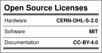

# MAKER'S ASYLUM INNOVATION SCHOOL
## 2026 Dusserah COHORT
## Chameleon Lamp

WHAT MADE US THINK ABOUT THIS? 
• We wanted lightning that intelligently responds to the surroundings rather than remaining fixed to a particular colour. 
• We took inspiration from nature – A chameleon changes colour to blend in with its surroundings. 
 
We decided to make a lamp that changes colour like a Chameleon. We also decided to give it the shape of a chameleon. 
 
Chameleon lamp has WS2812 RGB LED's driven by an ESP32, with a color sensor that allows the chameleon to change it color based on its surroundings. 

## License

Licenses

#### Hardware
CERN Open Hardware License Version 2 - Strongly Reciprocal ([CERN-OHL-S-2.0](https://spdx.org/licenses/CERN-OHL-S-2.0.html)).

#### Software
MIT open source [license](http://opensource.org/licenses/MIT).

#### Documentation:
 This work is licensed under a <a rel="license" href="http://creativecommons.org/licenses/by/4.0/">Creative Commons Attribution 4.0 International License</a>.

---

## 📬 Contact/Team

> _List team members and contact emails or GitHub profiles._
[@anool](https://github.com/Anool)
> 
>
> ---
